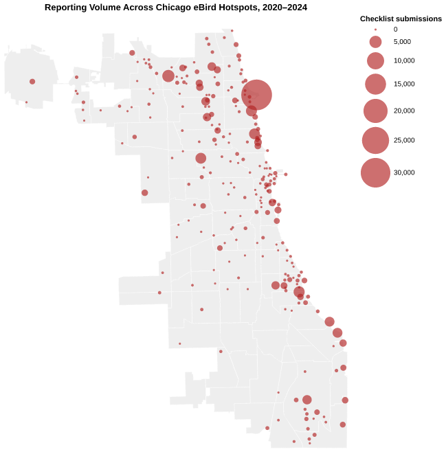
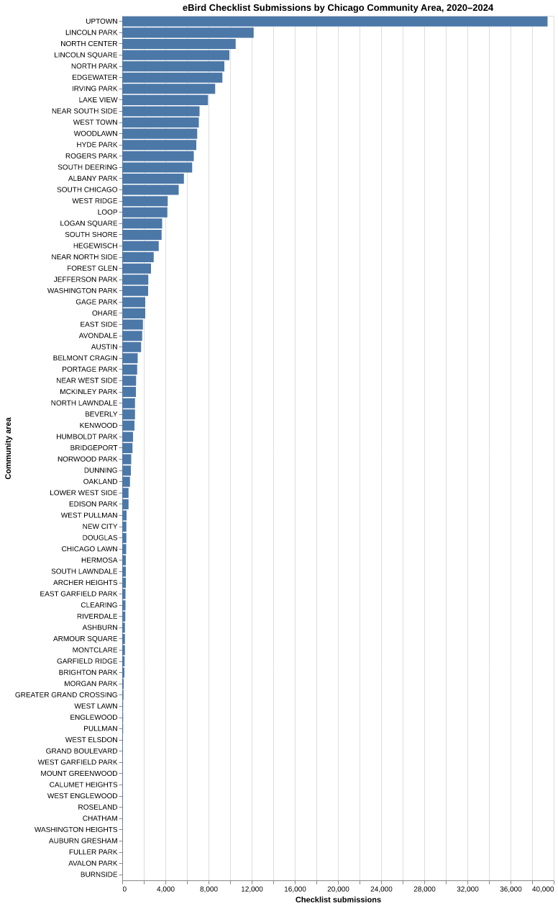
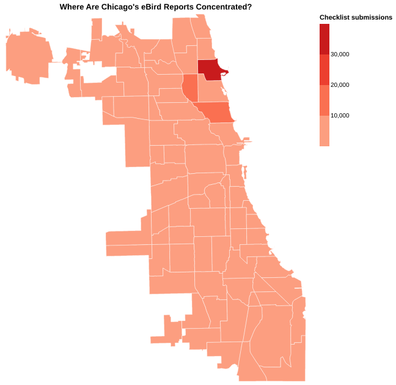
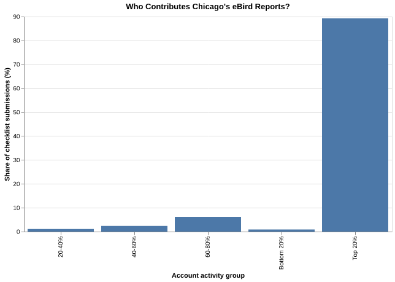
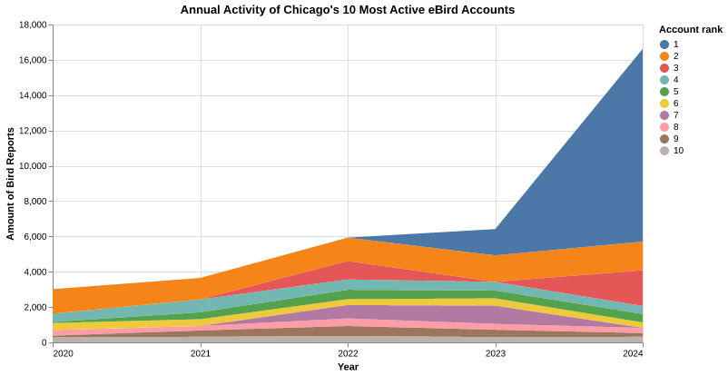
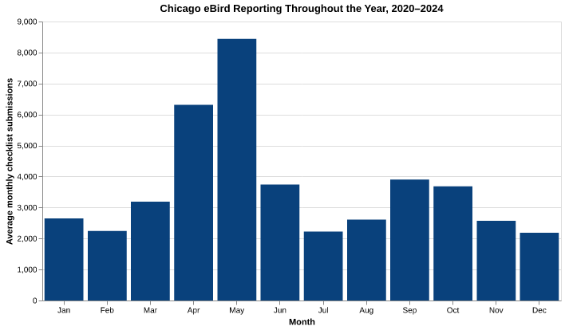
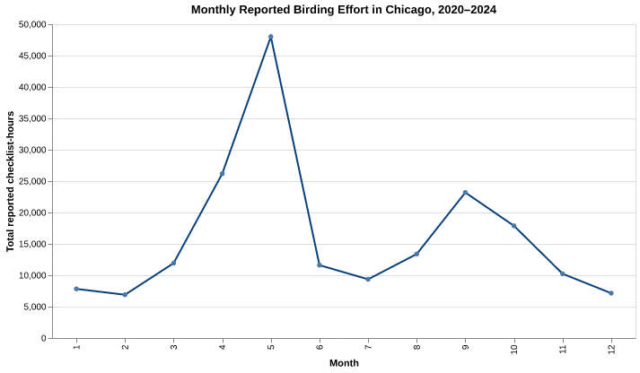
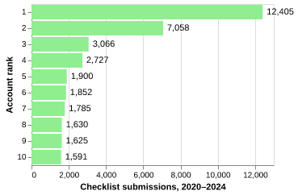

# Where Chicago's Birds Get Counted: eBird Reporting Across the City

## What is your current goal? Has it changed since the proposal?

My original question was which parts of Chicago receive less citizen-science attention than the amount of available habitat would suggest. That is still where I want the project to go, but I realized I needed to understand the eBird data before comparing it with parks or neighborhood characteristics.

For this draft, I'm looking at where people submit bird reports in Chicago, which locations account for most of the activity, and how much of the dataset comes from a relatively small group of contributors. I have 218,781 checklists from 2020–2024, assigned to Chicago's 77 community areas. They were submitted by 10,373 distinct eBird accounts. This measures reporting in Chicago, but not necessarily birding by Chicago residents.

## Are there data challenges you are facing? Are you currently depending on mock data?

The checklist records are from eBird, and the community-area boundaries are Chicago geographic data. The harder problem is interpretation: one account can submit thousands of checklists, the same outing can produce shared reports, and an eBird hotspot is a designated shared reporting location, not a direct measure of biodiversity.

The counts are also extremely uneven. Some community areas have only a handful of checklists, while Uptown has 39,441. Montrose Point alone has  32,320 submissions. That makes color scales difficult and raises the question of whether we're seeing broad neighborhood participation or heavy reporting at a few popular destinations. Not that this is necessarily bad, it just makes it tricky to build something creative-- but I do think this concentration is compelling. I haven't incorporated park acreage or neighborhood demographic variables yet, so I can't make claims about reporting relative to habitat or equity at this stage.

## Describe each of the provided images with 2–3 sentences to give the context and how it relates to your goal.

### Figure 1 — Reporting at individual eBird hotspots

Each circle marks an eBird hotspot (app designated birding area), with circle area representing the number of submitted checklists. There are 250 hotspot locations represented in my Chicago data, accounting for 135,684 checklists, or about 62% of all submissions. Montrose Point is by far the largest, suggesting that individual destinations can explain much of a community area's overall reporting volume-- likely because the monstrose bird sanctuary is up there!

This ranks all 77 Chicago community areas by eBird checklist submissions from 2020–2024. There are drastic differences-- places like Uptown have tens of thousands of reports, while Burnside has just one. I think this could be a good starting point for looking at gaps, or just having a gauge of what is happening in the city by neighborhood.

This puts those same checklist counts on a map, coloring Chicago's community areas by reporting volume. I'm testing a binned red scale because a continuous scale makes most of the low-reporting areas difficult to distinguish. Again this map is just geographic birding activity, not where the city's bird population is concentrated.

This map is bad and ugly. I grouped the 10,373 accounts into five equally sized groups based on how many Chicago checklists they submitted. The most active 20% of accounts generated 89.3% of all checklist submissions. That raises a separate question about how much of the map reflects the habits of repeat contributors rather than broad participation.

This stacked area chart shows how the top ten accounts contributed to their *combined* annual checklist total from 2020 through 2024. It is hard to read and not really getting across the right message. Each colored band's thickness represents one account's submissions in that year; the total height is not the number submitted by the top-ranked account. I'm still considering whether this is the clearest way to show changes over time.

This compares reporting across the twelve calendar months, I thought it would be cooler, averaging each month's checklist count over the five years to make the seasonal pattern easier to read. May has the highest reporting activity, while winter and midsummer months are generally lower. Those differences could reflect migration, observer behavior, weather, or a combination; submissions alone can't establish the cause.

This sums the reported durations of Traveling and Stationary checklists by calendar month across 2020–2024. The variables are specific, so it is tough to get across information. It is a different measurement from checklist frequency: some months may have more recorded observation time, even when the number of submissions is lower. These are reported checklist-hours, not a verified measure of unique person-hours, because outings and reports may overlap.

This ranks Chicago's ten most active eBird accounts by checklist submissions from 2020–2024. The most active account submitted 12,405 checklists, compared with 1,591 for the tenth-ranked account. Even among the most prolific contributors, reporting activity is heavily concentrated at the top. I'm not sure if this matters in the grand scheme of things, but I can't help but think it matters that the top 20% holds almost 90% of birding contributions.